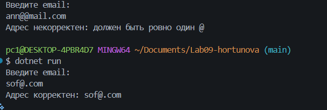
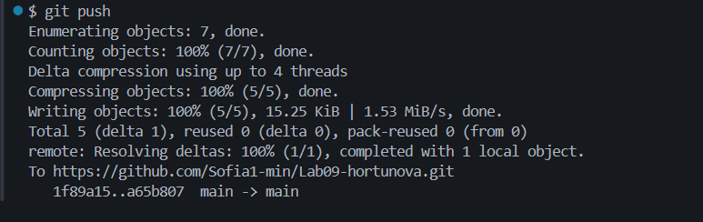

# Практическая работа №9

**ФИО:** Хортюнова София Юрьевна
**Группа:** ИСП-241
**Дата:** 23.10.2026

## Что изучено

- Методы строк (например, `ToUpper`) не меняют исходный текст, а возвращают новый.
- Строку можно перебирать циклом по индексам и проверять через `Contains`, `StartsWith` и `EndsWith`.
- `Substring` вырезает часть текста, а `StringBuilder` собирает новую строку по кусочкам.

## Скриншоты

********

